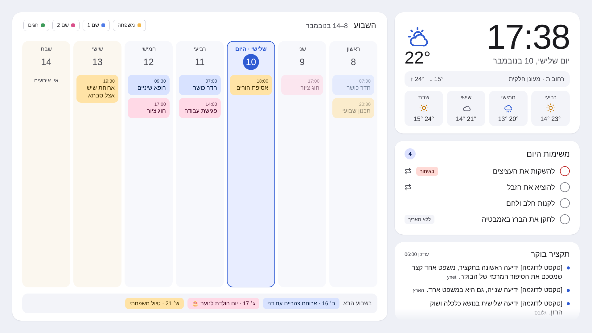
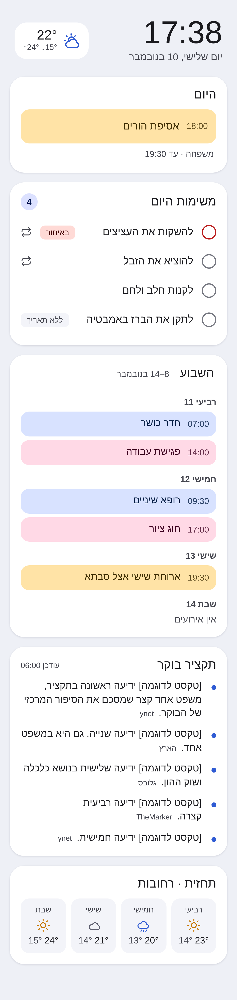

# Family Dashboard

A Skylight-style family screen for the TV, built on [MagicMirror²](https://magicmirror.builders) and running on a Raspberry Pi 5.
Hebrew, right-to-left, with weather for Rehovot.

```
┌──────────────────────────────────────┬──────────────────┐
│                                      │ Clock + weather  │
│  This week: 7 days, color per person │ + 4-day forecast │
│  (Family · Person 1 · Person 2 ·     ├──────────────────┤
│   Holidays)                          │ Today's chores   │
│                                      ├──────────────────┤
│  Next week's highlights              │ Morning news     │
└──────────────────────────────────────┴──────────────────┘
```
Light Material 3 design, Hebrew right to left. On a phone the cards stack in one column.

| Panel | Source | Who updates it |
|---|---|---|
| Calendar | Google Calendar (private iCal links) | Everyone, from Google Calendar on their phone |
| Todos + recurring chores | Todoist (free) | Everyone, from the Todoist app |
| Weather | Open-Meteo (free, no key) | Automatic |
| News briefing | ynet, Haaretz, TheMarker, Globes → summarized by Claude at 06:00 | Automatic |

**The TV only displays. All input happens on your phones.** The same dashboard opens on your phones from anywhere (see [View from anywhere](#view-from-anywhere)).

| TV (1920×1080) | Phone |
|---|---|
|  |  |

<sub>Previews rendered from the real modules with demo data (news text is placeholder).</sub>

## Try it on your Mac first (no Pi needed)

Everything runs in your browser. It uses the same code that will later run on the Pi.

**One-time:** install Node.js 22 LTS from [nodejs.org](https://nodejs.org). If Terminal asks for git, run `xcode-select --install`.

```bash
git clone https://github.com/tonyudo/hello-world.git family-dashboard
cd family-dashboard
npm run demo
```

The first run takes a few minutes while it downloads MagicMirror². Then `http://localhost:8080` opens by itself.

| Command | What you get |
|---|---|
| `npm run demo` | **Sample** calendars and chores for this week, plus **real** weather (Rehovot) and real news headlines. A yellow "מצב הדגמה" badge marks it as demo data. |
| `npm run real` | Your real accounts, read from `config/config.env` (see [step 3](#3-fill-in-your-links-and-keys)) |
| `npm test` | Unit tests for the custom modules |
| `npm run check-feeds` | Checks that each news feed works |

**While it's running:**
- Save `config/config.js`, `config/custom.css` or a module file and the page reloads by itself. Use this to try layout and feature changes.
- **Phone layout:** in Chrome, open DevTools (⌥⌘I) → device toolbar (⇧⌘M) → pick an iPhone.
- **TV size:** go fullscreen (⌃⌘F) on a 1080p screen, or set the device toolbar to 1920×1080.
- Stop with **Ctrl+C**.

MagicMirror is installed in `.magicmirror/` inside this folder (git ignores it). To start fresh, delete that folder.

## What you need

- Raspberry Pi 5 (4 GB is plenty) + official 27 W USB-C power supply + case + 32 GB microSD + micro-HDMI to HDMI cable. About ₪400–500.
- A Google account with a shared **Family** calendar and one calendar per person
- A Todoist account (free) with a shared project, e.g. "בית"
- An Anthropic API key, for the AI news summary. This is optional: without one the screen shows plain headlines.

## Setup (about 30 minutes)

### 1. Prepare the Pi
Flash **Raspberry Pi OS (64-bit, with desktop)** with Raspberry Pi Imager. In the Imager settings, set your Wi-Fi, a username, and turn on SSH. Boot the Pi plugged into the TV.

### 2. Install
On the Pi (in a terminal or over SSH):
```bash
git clone https://github.com/tonyudo/hello-world.git ~/family-dashboard
~/family-dashboard/scripts/install.sh
```
This installs Node.js, MagicMirror², the calendar and Todoist modules, and the news module from this repo. It also sets the dashboard to start on boot.

### 3. Fill in your links and keys
Edit `~/family-dashboard/config/config.env`. Git ignores this file, so it never leaves the Pi.

| Setting | Where to get it |
|---|---|
| `SECRET_CAL_FAMILY`, `SECRET_CAL_PERSON1`, `SECRET_CAL_PERSON2` | Google Calendar on a computer → ⚙ Settings → click the calendar → **Integrate calendar** → **Secret address in iCal format** |
| `SECRET_TODOIST_TOKEN` | Todoist → Settings → Integrations → Developer → API token |
| `SECRET_ANTHROPIC_API_KEY` | console.anthropic.com → API Keys (leave `REPLACE` for headlines only) |

To change who is who and their colors, edit the `calendars` list in `config/config.js` (`person1` = blue, `person2` = pink, `family` = amber, holidays = green).

### 4. Check the news feeds, then reboot
```bash
cd ~/MagicMirror && node modules/MMM-DailyTLDR/check-feeds.js
sudo reboot
```
`check-feeds` shows ✔ or ✘ for each feed. If one fails, find the outlet's current RSS link and replace it in `config/config.js`.

## View from anywhere

The Pi serves the dashboard as a web page. **Tailscale** lets your phones reach it from anywhere: a free private network that links only your own devices. Nothing is opened to the internet.

> ⚠️ MagicMirror has no login. **Never** open port 8080 on your router. Anyone who found it would see your family's schedule.

1. On the Pi: `~/family-dashboard/scripts/remote-access.sh`. Sign in with the link it prints. Google sign-in works.
2. On each phone: install **Tailscale** from the App Store or Google Play and sign in with **the same account**.
3. Open the address the script printed, e.g. `https://family-dashboard.tail1234.ts.net`. Then use **Add to Home Screen** so it opens like an app.

On a phone the page switches to a single column: clock → todos → this week's events → weather → news. The TV keeps its own layout. Both read the same data, so they always match.

| | |
|---|---|
| Works when | the Pi is on and online, and Tailscale is on in the phone |
| Cost | free (Tailscale Personal plan) |
| Fallback address | `http://family-dashboard:8080` (inside Tailscale) |

## Everyday use

- **Add an event:** add it to the Family calendar (or your own) in Google Calendar. It shows up on the TV within 5 minutes.
- **Add a chore:** add it to the shared Todoist project with a repeat ("every Sunday", "every day at 8pm"). The TV shows today's tasks, overdue tasks and tasks with no date.
- **News:** a new briefing is written every morning at 06:00 and stays up all day.

## Maintenance

| Task | Command |
|---|---|
| Restart the screen | `~/family-dashboard/scripts/restart.sh` |
| Pull config changes from GitHub | `~/family-dashboard/scripts/update.sh` |
| Also update MagicMirror and the modules | `~/family-dashboard/scripts/update.sh --all` |
| See the logs | `tail -f ~/.cache/family-dashboard.log` |
| Open the dashboard from another device | `http://<pi-ip>:8080` |

### TV schedule (saves power, prevents burn-in)
Turn on **HDMI-CEC** in the TV's settings. Samsung calls it Anynet+, LG calls it SimpLink, Sony calls it Bravia Sync. Then test it:
```bash
~/family-dashboard/scripts/tv.sh off
~/family-dashboard/scripts/tv.sh on
```
If both work, run `crontab -e` and add these lines. The TV turns on at 06:30 and off at 23:00:
```
30 6 * * * /home/<you>/family-dashboard/scripts/tv.sh on
0 23 * * * /home/<you>/family-dashboard/scripts/tv.sh off
```
**OLED TV?** Use the schedule. A screen that never changes can burn in.

## Costs

| Item | Cost |
|---|---|
| Raspberry Pi 5 kit | one-time, about ₪400–500 |
| Google Calendar, Todoist free tier, Open-Meteo | free |
| News summary (Claude Opus 5.5, once a day) | about $2 a month. Set `model: "claude-haiku-5-5"` in the news module config to pay about $0.05 a month. |

## Repo layout

```
config/config.js            layout, calendars, location, feeds (no secrets)
config/config.env.example   template for your private links and keys
config/custom.css           TV styling: large Hebrew font, RTL, overscan margins
modules/MMM-DailyTLDR/      custom module: RSS → Claude → 5-bullet Hebrew briefing
modules/MMM-ClockWeather/   clock + weather card and phone forecast (Open-Meteo)
modules/MMM-WeekCalendar/   week grid (TV), day list + today card (phone)
modules/MMM-Chores/         today's chores from Todoist
modules/MMM-PhoneView/      makes phones use the stacked layout
modules/MMM-Demo/           sample calendars & chores for demo mode (MM_DEMO=1)
scripts/local.sh            run on a Mac/Linux laptop in the browser (demo or real)
scripts/install.sh          Raspberry Pi setup; shares its steps with local.sh via scripts/lib.sh
scripts/                    also: run, restart, update, TV on/off, remote access
```

## Roadmap

- [ ] Photo slideshow at night or when idle (Google Photos album)
- [ ] Forward a school or clinic email → an event is created automatically
- [ ] Shopping list panel (a Todoist "קניות" project)
- [ ] Touch screen: tap to check off chores
